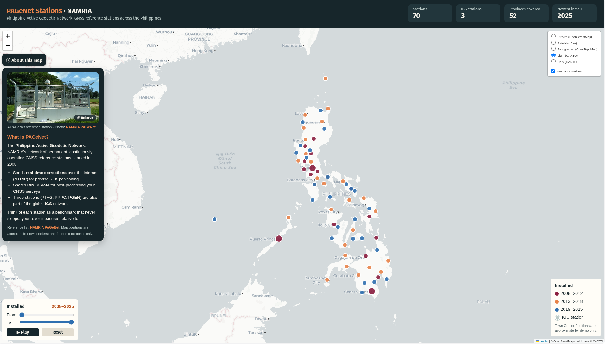
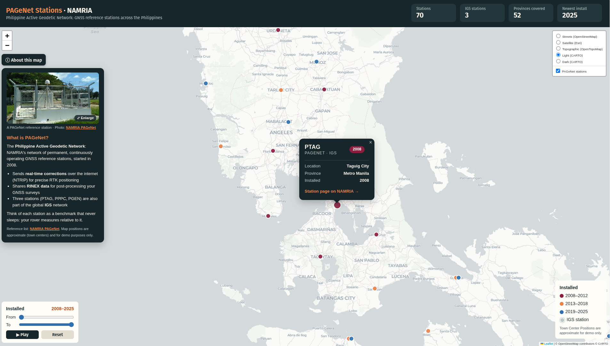
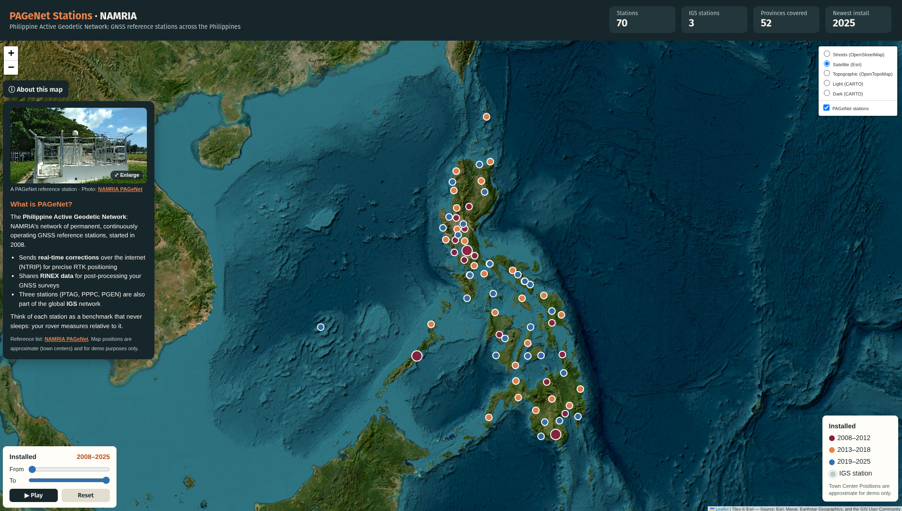
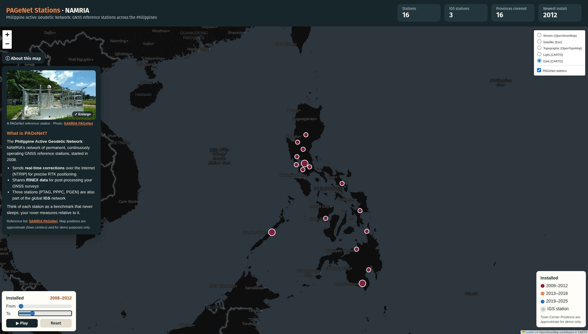

<h1 align="center">🌌 Nebula Atlas 🗺️</h1>

<p align="center">Every map starts as a nebula.</p>

<p align="center">
  
</p>

<table>
  <tr>
    <td width="33%"></td>
    <td width="33%"></td>
    <td width="33%"></td>
  </tr>
</table>

Nebula Atlas is a starter kit for building **interactive web maps and geospatial dashboards**. It starts with one GeoJSON file and one HTML page, then grows into a full-stack app with Django, React and MUI.

> First used at the hands-on workshop **"Building Interactive Web Maps and Geospatial Dashboards"** for UP Geodetic Engineering students, November 7, 2026.

## Versions

| Version | Branch | Stack | Status |
|---|---|---|---|
| **v1.0.0** | `1.0.0` | HTML, CSS, JavaScript, Leaflet | ✅ Ready |
| **v2.0.0** | `2.0.0` | React, Vite, MUI, Django REST API | 🚧 In progress |

**Live demo:** [v1.0.0](https://nebula-atlas-v1.onrender.com) · v2.0.0 coming soon

## v1.0.0: PAGeNet Stations

A dashboard of the **Philippine Active Geodetic Network (PAGeNet)**, NAMRIA's nationwide network of continuously operating GNSS reference stations, built as a single HTML page.

- 🗺️ **70 stations** on one map, colored by installation era, with the three IGS stations highlighted
- 🔢 **KPI cards:** stations, IGS stations, provinces covered, newest install
- 🎚️ **Year filter** with ▶ Play, to watch the network grow from 2008 to 2025
- 🌍 **Basemap switcher:** Streets, Satellite, Topographic, Light and Dark
- 💬 **Hover labels and station popups** with links to each station's NAMRIA page
- ⓘ **About panel** explaining PAGeNet, with a full-screen station photo
- 📱 **Phone layout** with a compact header, a folded switcher and touch-friendly controls

### Run it locally

Browsers block `fetch()` from files opened directly (`file://`), so serve the folder with a small local server:

```bash
git clone https://github.com/YOUR-USERNAME/nebula-atlas.git
cd nebula-atlas
git switch 1.0.0
python3 -m http.server 8080
```

Open **http://localhost:8080**. Stop the server with `Ctrl+C`.

No Python? Use the **Live Server** extension in VS Code (right-click `index.html` → *Open with Live Server*) or run `npx serve .`.

### Files

```
nebula-atlas/
├── .gitignore                    # Keeps config.js, .env files and build output out of Git
├── config.example.js             # Template for your private settings
├── config.js                     # Your CARTO key (you create this; never committed)
├── images/
│   ├── sample_pagenet_gnss.jpg   # Station photo for the About panel
│   ├── splash_0.png              # README cover
│   ├── splash_1.png              # README screenshots
│   ├── splash_2.png
│   └── splash_3.png
├── index.html                    # The whole map: HTML, CSS and JavaScript
├── LICENSE
├── pagenet_stations.geojson      # 70 PAGeNet stations (approximate positions)
└── README.md
```

### Optional: CARTO basemaps

The Light and Dark basemaps need a free CARTO API key. Without one, the map opens on Streets and everything else still works.

```bash
cp config.example.js config.js
```

Then paste your key into `config.js`:

```js
window.NEBULA_CONFIG = {
  CARTO_API_KEY: "your-key-here",
};
```

`config.js` is in `.gitignore`, so your key is never committed. Anything a browser loads is public, though, so **restrict the key to your domains** (`localhost` and your live site) in the CARTO dashboard.

### Try this

1. Find the PAGeNet station nearest your home town.
2. Change the year ranges or colors in `eras`.
3. Add a KPI: how many stations were installed in 2014 alone?
4. Replace `pagenet_stations.geojson` with your own export from QGIS (EPSG:4326).

## About the data

The station list (codes, locations, provinces, installation years) comes from [NAMRIA's PAGeNet page](https://pagenet.namria.gov.ph/AGN/AGSmain.aspx).

> ⚠️ **Positions are approximate.** Each station is placed at the center of its host town or city ([GeoNames](https://www.geonames.org), CC BY 4.0), not at the actual monument. This map is for **teaching and demo purposes only**. Do not use it for surveying. For official station coordinates, contact NAMRIA.

The station photo is from NAMRIA PAGeNet.

Two GeoJSON reminders:

- **Coordinates are `[longitude, latitude]`.** Leaflet's `setView` and `L.marker` want `[latitude, longitude]`, the reverse.
- **GeoJSON is WGS84 (EPSG:4326).** Reproject PRS92, PPCS or UTM data before exporting from QGIS.

## Deploy

v1.0.0 is a static site, so it needs no server code. On [Render](https://render.com):

1. **New → Static Site**, then connect this repo.
2. **Branch:** `1.0.0`
3. **Build command:** `echo "window.NEBULA_CONFIG = { CARTO_API_KEY: \"$CARTO_API_KEY\" };" > config.js`
4. **Publish directory:** `.`
5. Add an environment variable `CARTO_API_KEY` (optional), then click **Create Static Site**.

Each push to `1.0.0` redeploys the site.

## Resources

- [GeoJSON specification (RFC 7946)](https://datatracker.ietf.org/doc/html/rfc7946)
- [geojson.io](https://geojson.io)
- [Leaflet](https://leafletjs.com) · [MapLibre GL JS](https://maplibre.org)
- [Django](https://docs.djangoproject.com) · [Django REST Framework](https://www.django-rest-framework.org)
- [React](https://react.dev) · [MUI](https://mui.com) · [Vite](https://vite.dev)
- [QGIS documentation](https://docs.qgis.org)
- [NAMRIA PAGeNet](https://pagenet.namria.gov.ph/AGN/AGSmain.aspx)

## License

[MIT](LICENSE). Use it, change it, and build on it.

Created by **Franz Raymond Bala**

Questions or ideas? [Open an issue](../../issues).
